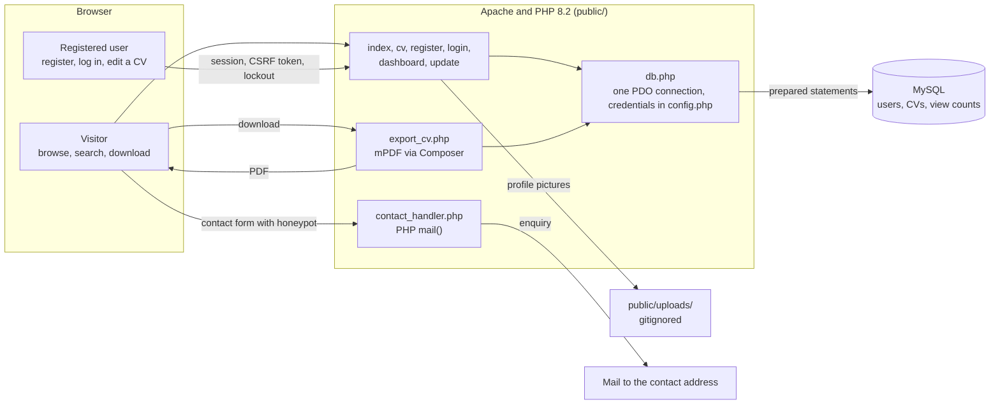

# AstonCV

[](https://github.com/zaccesss/astoncv/releases/latest)
[](LICENSE)
[](CHANGELOG.md)
[](#live-site)

> [!IMPORTANT]
> This repository is archived. AstonCV was built as university coursework and is kept here as it was submitted, with later fixes. The idea continues as [Vitafolio](https://github.com/zaccesss/vitafolio), a new project rebuilt from scratch in Laravel.

AstonCV is a full-stack CV database website, built as a university portfolio project in plain PHP and MySQL. Anyone can browse and search student CVs publicly, register an account, manage their own CV once logged in and download any CV as a professionally formatted PDF.

## Quick Navigation

<p align="center">
  <a href="#live-site">Live Site</a> •
  <a href="#how-it-works">How It Works</a> •
  <a href="#documentation-hub">Documentation</a> •
  <a href="#tech-stack">Tech Stack</a> •
  <a href="#repository-structure">Structure</a> •
  <a href="#contact-and-support">Support</a>
</p>

---

<a id="live-site"></a>

## Live Site

There is no live version any more. The site ran on a university server that has since been shut down. The project continues as [Vitafolio](https://github.com/zaccesss/vitafolio).

---

<a id="how-it-works"></a>

## How It Works



Every page is a plain PHP file under `public/`, served directly by Apache. They share one PDO connection from `db.php` and every query is a prepared statement. PDF export builds the CV as HTML and hands it to mPDF, so no login is needed to download.

---

<a id="documentation-hub"></a>

## Documentation Hub

<p align="center">
  <a href="DOCUMENTATION.md">Full Documentation</a> &nbsp;•&nbsp;
  <a href="SECURITY.md">Security Policy</a> &nbsp;•&nbsp;
  <a href="CONTRIBUTING.md">Contributing</a> &nbsp;•&nbsp;
  <a href="CHANGELOG.md">Changelog</a> &nbsp;•&nbsp;
  <a href="ROADMAP.md">Roadmap</a>
</p>

See [DOCUMENTATION.md](DOCUMENTATION.md) for the full feature list, security implementation detail and local setup instructions.

---

<a id="tech-stack"></a>

## Tech Stack

<div align="center">

|  |  |  |  |  |
|:---:|:---:|:---:|:---:|:---:|
| **PHP 8.2** | **MySQL** | **HTML5** | **CSS3** | **JavaScript** |

|  |  |  |  |  |
|:---:|:---:|:---:|:---:|:---:|
| **Git** | **GitHub** | **Composer** | **Apache** | **XAMPP** |

</div>

---

<a id="repository-structure"></a>

## Repository Structure

```
astoncv/
├── public/                  Web root, everything the server serves directly
│   ├── index.php            Homepage: browse, search, filter and sort all CVs
│   ├── cv.php                Full CV detail page with download PDF and print buttons
│   ├── register.php          New user registration
│   ├── login.php              Login with CSRF protection and brute force lockout
│   ├── update.php             Update CV details, profile picture and password
│   ├── dashboard.php          Personal dashboard shown after login
│   ├── logout.php             Destroys the session and redirects to the homepage
│   ├── export_cv.php          Generates and downloads a CV as a PDF using mPDF
│   ├── contact_handler.php    Processes the contact form
│   ├── db.php                 Shared PDO database connection
│   ├── config.php             Database credentials, gitignored
│   ├── config.example.php     Placeholder credentials safe for GitHub
│   ├── style.css              Full custom stylesheet
│   ├── images/                Campus photography used across all pages
│   └── uploads/                User profile picture storage, gitignored
├── vendor/                   mPDF library, gitignored, installed via Composer
├── composer.json              mPDF dependency declaration
├── DOCUMENTATION.md            Full feature list and security detail
└── CHANGELOG.md                What changed and when
```

---

<a id="contact-and-support"></a>

## Contact and Support

> [!TIP]
> This project is maintained by Isaac Adjei. Questions and bug reports can be raised as an [issue](https://github.com/zaccesss/astoncv/issues) in this repository. Reach me directly at [contact@isaacadjei.me](mailto:contact@isaacadjei.me) or through [isaacadjei.me/contact](https://isaacadjei.me/contact).

> [!IMPORTANT]
> Found a security issue? Do not open a public issue, see [SECURITY.md](SECURITY.md) for how to report it privately.

See [NOTICE.md](NOTICE.md) for licensing details on the campus photography and [LICENSE](LICENSE) for the MIT licence covering the project code.
